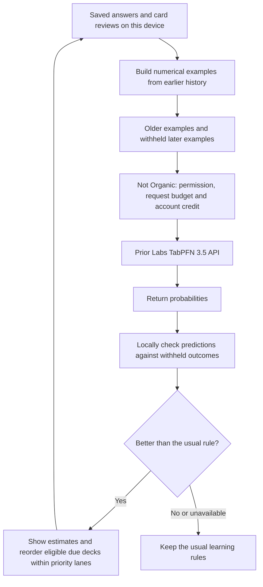
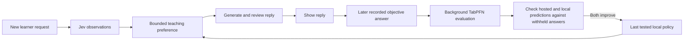

# Online tabular learning in Keating

Keating uses an optional hosted TabPFN 3.5 policy in web Coming Up and mobile Learn, and can use observed outcomes to improve later chat turns through a saved local policy. Background learning is the default chat mode when a tabular model is enabled; live comparison of checked replies is an explicit experimental option. The old imported shallow-tree/CatBoost policies are no longer loaded or applied there. Their training tools, exported trees and evidence verifiers remain available for reproducible comparisons. The terminal also ignores its old fitted-quiz environment variables; its ordinary judgement-model quiz estimates continue.

## What “offline training” meant

The previous workflow collected a dataset, ran a separate Python fitting job, evaluated the resulting trees, exported them to JSON and imported that fixed artifact into the app. The browser/mobile app could then evaluate those trees locally. It did not retrain CatBoost when a learner answered a question. New evidence required another fitting job and another artifact installation.

TabPFN is already pretrained. Keating supplies a small table of historical examples and asks it to predict additional rows. Adding a saved answer changes the examples for a later request; Keating does not update TabPFN's pretrained weights. This is online adaptation through inference. The hosted protocol still has several steps—upload, fit/context preparation, predict and deletion—behind one Not Organic route.

## What the loop does

Three independent predictions use different evidence:

| Target | What the number predicts | Example inputs | Current effect |
| --- | --- | --- | --- |
| Next answer, called mastery in code | Correctness on a later distinct, automatically scored question | Earlier answer count, average, last score, elapsed time | An advisory estimate; never a replacement for a grade or demonstrated mastery |
| Retention | Successful recall on a delayed card review | Earlier recall/lapse rates, interval, elapsed time, prior objective results when known | A card-level recall estimate; never a rewrite of SRS dates |
| Urgency | Lapse risk on the first observed due-card review in a day | Due/overdue counts, prior lapses and recall, time overdue | Can reorder due decks inside existing priority lanes |

Actual saved outcomes supply the labels. Model-graded prose does not become an objective question label. A card marked Good/Easy supplies a successful-recall label; Again supplies a lapse. Unreviewed decks are unobserved, rather than invented successes or failures. Missing history has explicit presence flags. Old web review records that lack the exact post-review schedule stay unknown; new reviews now save that schedule.

Each target needs at least 20 training observations and 5 later validation observations, with both outcomes represented in each partition. These are observations eligible for that target, not simply 25 clicks. Urgency additionally needs at least 3 comparable pairs across 2 review-day cohorts. The latest chronological slice is withheld; equal-time groups stay together. Training is capped at 500 rows, validation at 32, and validation plus current queries at 64. The existing source reconstruction has an independent limit of 2,000 recorded events; exceeding it retains baseline and exposes a reason in the local receipt.

The device keeps validation answers local and sends only their input features. It measures mastery classification error, retention squared probability error, and urgency pair-ranking error. A candidate must strictly improve the relevant rule; urgency must beat both web and mobile baseline ordering. These small within-person checks are practical activation gates, not proof of future accuracy. Validation history is reused across updates and has not become an untouched research test set.

A stable 10% of queue positions retain their usual order. Learner-selected priorities, grades and review dates remain authoritative. These three queue policies do not select teaching replies. The separate chat policy below uses a different outcome table and cannot change source code, authorize tool calls, change the selected judgement model, or bypass the draft gate.

## Two independent chat loops

A live conversation never awaits TabPFN in **Background learning** mode. At the start of a reviewed turn, Keating captures the last tested local policy. The configured decision model still interprets the request and the text model still generates privately reviewed replies. The captured policy can supply a preference among activity formats that the ordinary planner already permits. It cannot create a new tool permission, weaken a teaching check, replace a grade, redirect an open interaction, or override an explicit practice request. Jev's original probabilities remain available without being rewritten into more convenient answers.

Background work runs separately as new objective outcomes accumulate. It can finish while the learner is still chatting. A successful update is saved for a later turn; an in-progress turn keeps its original snapshot. Failure retains the previous snapshot until it expires. This removes the tabular service from the learner's reply wait, but does not remove the ordinary text-generation and judgement latency.

The first implementation uses the existing eight judgement signals: requested explanation/practice, stated difficulty, an attempted answer, a supported misconception, and properties of the material. Their probabilities and presence flags remain separate from six recorded counts. Missing observations remain unknown. These are fixed feature meanings, not automatically invented questions.

The background predictor receives those 22 observation columns plus seven activity-format indicators: prose, question, recall, simulation, visual, practice and mixed. Reply length is deliberately excluded: this policy is used before the reply is written. The device chooses representative contexts only from training history, asks TabPFN to score supported formats in those contexts, and stores the numerical results as a compact local prototype policy. Serving that policy uses local numerical comparisons; it does not call the provider or import CatBoost.

Historical examples are split chronologically. There must be at least 20 training outcomes and 5 later validation outcomes, with enough recorded examples for the formats being compared. Training outcomes must have been observed before the validation examples were presented. Validation labels stay on the device. **Both** TabPFN's held-out predictions and the local policy's held-out predictions must improve on the historical format-mean baseline. A good hosted model with a poor local approximation cannot be activated. The policy also checks feature version, the fingerprint of the exact observation questions, exact judgement-model identity, and whether the current context is supported; otherwise the ordinary planner is used. Policies expire after 24 hours. Legacy observations without a question fingerprint, or observations from different question definitions, remain readable but cannot train this background policy. These are prediction gates, not evidence of causal teaching effectiveness or the independent behavioral gates used to activate teaching-source revisions.

The job has its own lifetime and timeout. Completing a chat turn does not cancel a valid background update. Account changes, disabled learning, revoked authorization, and cleared/replaced history prevent the result from being saved or used. Repeated identical evidence is deduplicated and updates are spaced apart. Learning while the app is open does not add an operating-system background service or cross-device sync.

## What supplies an outcome

Only the reply actually published is recorded. Its assessment links use the same document, revision and node identifiers as the learner UI. The first recorded, automatically scored answer on a matching source can supply a label. Another published teaching reply closes the earlier attribution window; an old intervention cannot silently inherit an answer after later teaching. Answers must arrive within 24 hours. Missing, repeated, ambiguous, model-graded and mismatched-source answers remain unknown. Published also does not prove the learner viewed the reply.

The target is **the score on the next linked objective answer**. First recorded does not mean unaided. Correctness on that answer does not establish retention, transfer, or a causal improvement over another activity. A diagram without a linked question stays unlabelled. A prose explanation can link to a real open assessment; otherwise it also stays unlabelled. This avoids inventing successes or failures for activities whose outcomes were not measured.

The history holds at most 500 exposures and starts with recorded publications; old transcripts are not retroactively turned into labelled examples. Historical examples from different conversations can contribute within the same account on this device, provided they satisfy the same attribution and judgement-model rules.

## Experimental live reply comparison

**Live reply comparison** preserves the earlier experimental path. After candidates pass the teaching checks and the ordinary semantic selector accepts one, TabPFN may compare supported formats using linked outcomes. Its table has 30 columns, including actual reply length. Only this explicit mode can await the hosted predictor inside a reviewed turn, for up to 15 seconds within the remaining draft budget. Failure retains the semantic selection. Tool-call turns do not enter this ranking, and TabPFN cannot recover a rejected draft or override `no_match`.

## Relationship to autoresearch feature discovery

The [TypeSafe feature-discovery cookbook](https://docs.typesafe.ai/cookbooks/autoresearch_feature_discovery) uses a text model to propose questions, Jev to turn examples into numbers, and prediction errors to guide further proposals. That is a suitable next research layer. This implementation establishes the asynchronous scheduling, outcome evidence, local serving policy, and validation boundary using the existing observations. It does **not** yet autonomously add, revise or drop Jev questions, retrain Jev, or rewrite source prompts.

Adding that research layer requires retaining appropriate pre-decision source evidence, versioning the question definitions alongside each feature table, re-evaluating historical examples for changed definitions, and validating the resulting local policy. A background TabPFN prediction by itself does not create improved prompt text or a reusable decision rule.

## Settings, updates and data flow

In web Learning settings or mobile Settings, connect online predictions to grant the separate `tabular:predict` permission, then select **TabPFN 3.5** under **Tabular model**. The default is **Off**. The model and chat-mode preferences are account-scoped and local to the device. Chat defaults to **Background learning**; **Live reply comparison** requires an explicit selection. Changing accounts clears in-memory predictions. Revoking authorization, turning the setting off, or receiving changed evidence prevents an old response from being used.

Web chat already uses private draft review. Mobile uses the shared private review path for this feature when online activity learning and its existing judgement model are enabled. Private native drafts cannot execute tools or stream to the learner; only the released result enters the normal tool loop. The selected judgement model still supplies the request assessments and checks.

Chat prediction history stays in an account-scoped local ledger, separate from portable learner exports. Mobile data replacement or clearing invalidates it. Web Learning settings can clear chat prediction history, and clearing the site's browser data also removes it. This does not add cross-device synchronization.

The model catalogue comes from authenticated `GET /v1/tabular/models`. It reports availability, limits and the configured per-batch price without running inference. Only implemented models are listed. The server has a model registry for later providers; adding an NVIDIA or other model requires an adapter, validation and corresponding supported model IDs in clients. It is not currently offered as an unverified choice.

Queue updates run while web Coming Up is open or mobile Learn is focused and foregrounded. New evidence or a new hourly time bucket invalidates cached results. The coordinator spaces update cycles by at least a minute and keeps receipts through page navigation. One queue cycle can make up to three paid prediction batches. An eligible background chat update can add a paid prediction batch, with the existing per-request spending limit. Experimental live comparison can instead add a batch to an eligible reply. Cold starts and unsupported comparisons make no tabular request. Background updates do not hold chat replies; the live comparison has its separate 15-second limit. There is no background daemon, automatic cross-device synchronization or infinite training job. Device history remains local until converted into a request.

The request contains numerical feature columns, older numerical outcome labels and numerical rows to predict. Names, topic strings, IDs, question/answer text, card content and session transcripts are not included. Numeric learning history still leaves the device: it passes through Not Organic to Prior Labs. The server-only API credential is never bundled into either client. Not Organic stores the numerical response for idempotency; the SDK deletes the uploaded training dataset, including the provider's test-data cascade, and treats cleanup failure explicitly.

## Server activation

The implementation is in the sibling `notorganic-provider` workspace. Its dependency-free TypeScript package is `packages/tabpfn-client`; Keating browser/mobile code calls the authenticated gateway instead of importing that SDK or using a Prior Labs key.

`POST /v1/tabular/predict` verifies DPoP and permission, validates the bounded numerical schema, reserves credit within the request budget, invokes the model, and settles the configured fixed price. It requires an idempotency key. The gateway limits each process to one active operation per account, eight overall, and six attempts per account per minute. Durable wallet reservations provide the financial boundary across replicas. Unknown delivery/settlement can incur the conservative reserved amount because provider computation may already have begun.

The service requires `TABPFN_API_KEY` and a deliberately chosen positive `TABPFN_PRICE_MICROUSD_PER_REQUEST`. Missing configuration reports the model unavailable. No retail price was invented from the provider's token quote. See the provider's `apps/gateway/src/tabular.INSTALL.md` for the complete contract and installation details.

This change has not deployed either application or provisioned those production variables. The stored Skate key was used only for live SDK and benchmark verification. End-to-end production account charging and physical-device behavior remain separate checks.

## What the evidence currently says

The [paired live benchmark](tabular-policy-benchmark.md) reused exactly the original 176 training and 112 validation rows for each target. TabPFN reduced retention loss by 7.52% and urgency ranking loss by 16.13%. Mastery loss increased by 2.57% versus the deterministic incumbent; that earlier run had rejected its shallow tree and never produced a CatBoost mastery model.

Those labels were saved Jev probabilities on harness scenarios. They show agreement with that teacher under the saved metrics, not observed learning gains. Live personal activation instead uses saved outcomes. Neither TabPFN's pretraining nor a fast forward pass tells us which input is causal. Establishing that a different review order improves learning needs an appropriate intervention and later retention/transfer outcomes.
