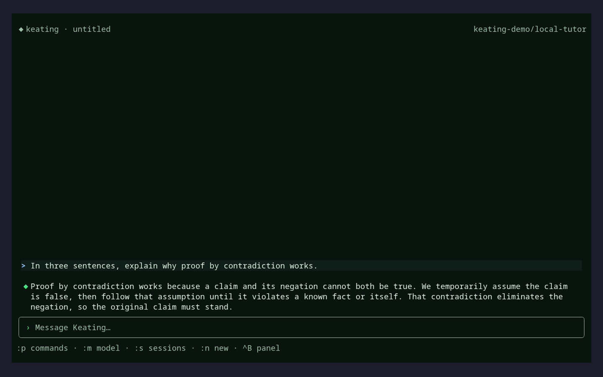
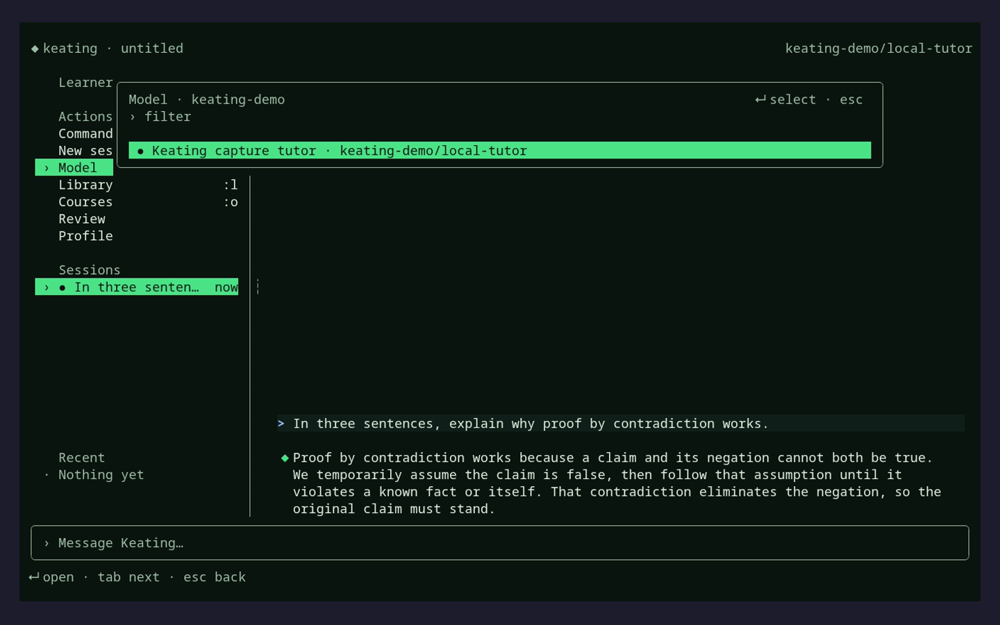
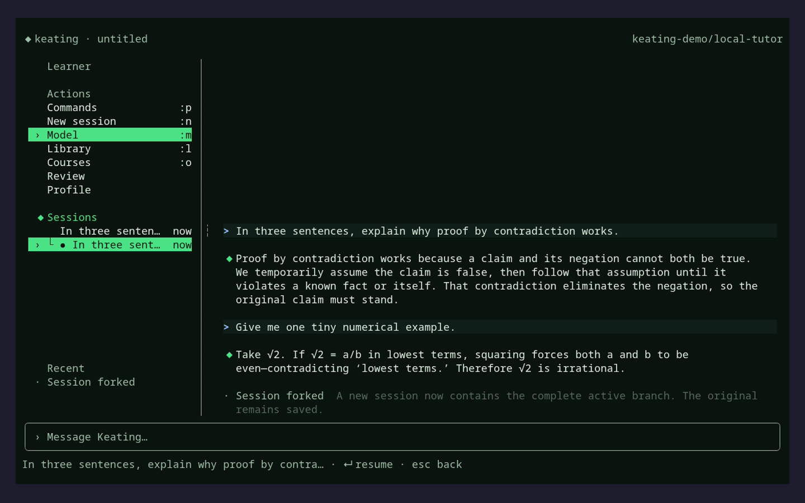

# Sacred terminal surface

Keating adapts the interaction grammar of the official [Sacred Computer component catalog](https://www.sacred.computer/) to native OpenTUI renderables. It does not load Sacred's React runtime in the terminal. The adaptation keeps Keating's own paper, ink, phosphor, and amber semantic colors while preserving the parts that make Sacred useful: layered windows, exact selection state, action bars, and tree lineage.

The terminal is not a small browser. Where the web mirrors chat bubbles with portraits, the TUI writes a single column of text:

- **One glyph per turn, no names.** A learner turn is `>` on a faint band; Keating is `◆`; tools are `→`, artifacts `▣`, notices `·`, errors `✕` (ASCII: `>`, `K`, `->`, `#`, `.`, `X`). The glyph is the only identity, so a turn costs zero extra rows.
- **Weight follows importance.** Tool calls and short notices are one dim line (`→ read  notes.md (+40 lines)`); prose turns are Markdown under a hanging gutter; only artifacts get a bold heading.
- **Bottom-anchored.** The conversation sits on the composer, the way a terminal scrolls, instead of floating under an empty pane.
- **Generated components are Markdown.** Quizzes, goals, study plans, decks, and models render as numbered questions, task lists, tables, and fences, with one italic pointer when a richer surface (web, desktop) is needed. Lifecycle and revision bookkeeping stays out of the transcript.
- **Chrome is quiet.** The header is `◆ name · session · model`; the status line is a short `key action` list; overlays put their keys flush right on the title row.

## Component map

| Sacred contract | Keating implementation |
| --- | --- |
| Badge, ActionButton, ActionBar | `src/tui/sacred.ts` |
| Message, MessageViewer (gutter glyphs, no bubbles) | `src/tui/sacred-transcript.ts` |
| Generated components as Markdown | `src/tui/ui/render.ts`, `src/core/cards.ts` (`toolResultCard`) |
| SidebarLayout, ListItem, draggable handle | `src/tui/sacred-sidebar.ts` |
| TreeView | `src/tui/session-browser.ts` |
| Card, Window, Dialog, Popover behavior | `src/tui/opentui-host.ts` |

Opaque values such as session paths remain separate from bounded display labels. Every surface has a Unicode and ASCII presentation, exposes keyboard focus, and retains direct click behavior where the terminal reports mouse events.

## Portrait assets

The following original generated artwork is stored with the landing-page assets:

- `web/public/avatars/keatingbot-newsprint.png` — a style-preserving interpretation of the canonical `web/public/brand/mascot-head-v2.png`; the cream CRT housing, green screen, black bezel, side pods, and single antenna remain the identity anchors.
- `web/public/avatars/learner-newsprint.png` — an original fictional learner portrait.
- `web/public/avatars/tutor-newsprint.png` — an original fictional tutor portrait.

All three were generated for Keating on 2026-08-25. They use original or project-owned reference material and contain no stock photography or real-person likeness. Setup can still reduce a learner-selected local image into a four-column by two-row Braille or ASCII avatar stored in the TUI profile (it never fetches avatar URLs), but the transcript and side panel no longer draw portraits: in a text column the glyph gutter identifies each turn more cheaply.

## Recorded proof

The landing-page tape deck uses two reproducible VHS recordings of the current `keating tui` source host:

| Flow | Recording source | Documentation master | Landing asset |
| --- | --- | --- | --- |
| Messages, model layer, and complete-branch fork | `docs/tui-collaborative.tape` | `docs/assets/tui-collaborative.mp4` | `web/public/tapes/tui-collaborative.mp4` |
| First-run name, portrait, local-image raster, and focus tour | `docs/tui-onboarding.tape` | `docs/assets/tui-onboarding.mp4` | `web/public/tapes/tui-onboarding.mp4` |

Still frames live in `docs/assets/screenshots/`. The onboarding sequence is preserved as direct application captures: `tui-startup-logo.png`, `tui-startup-compact.png`, `tui-onboarding-name.png`, `tui-onboarding-avatar.png`, `tui-onboarding-custom-avatar.png`, and `tui-onboarding-complete.png`. The onboarding tape deliberately starts without credentials, holds the full startup lockup until Enter, then records the real name and local-image path controls. The collaborative tape uses the loopback-only fixture in `scripts/tui-demo-provider.mjs` and `docs/fixtures/tui-demo-*.json`; it exercises the production transcript, model picker, session persistence, and fork tree without network access or operator secrets. Validate the sources with `vhs validate docs/*.tape` before recording them again.

## Component workshop and still frames

The [Textbook workshop](../textbook/README.md) lets you inspect the production
transcript and sidebar with offline fixtures, including streaming, errors,
session lineage, keyboard navigation, light colors, and ASCII fallbacks.
Run `devenv tasks run keating:textbook` and open <http://127.0.0.1:6007>.

These current captures show the production terminal host with an isolated
workspace and loopback demo provider. Regenerate them with
`rtk devenv tasks run keating:docs-screenshots`. The source is
[`docs/tui-screenshots.tape`](tui-screenshots.tape), with dates and revision in
the [capture manifest](../scripts/docs-site/assets/screenshots/captures.json).

## Upstream acknowledgment

The component behavior was studied from Sacred/SRCL's public component documentation and TypeScript sources, distributed under the MIT license. Keating's OpenTUI code is an independent adaptation and retains an acknowledgment in `src/tui/sacred.ts`.
